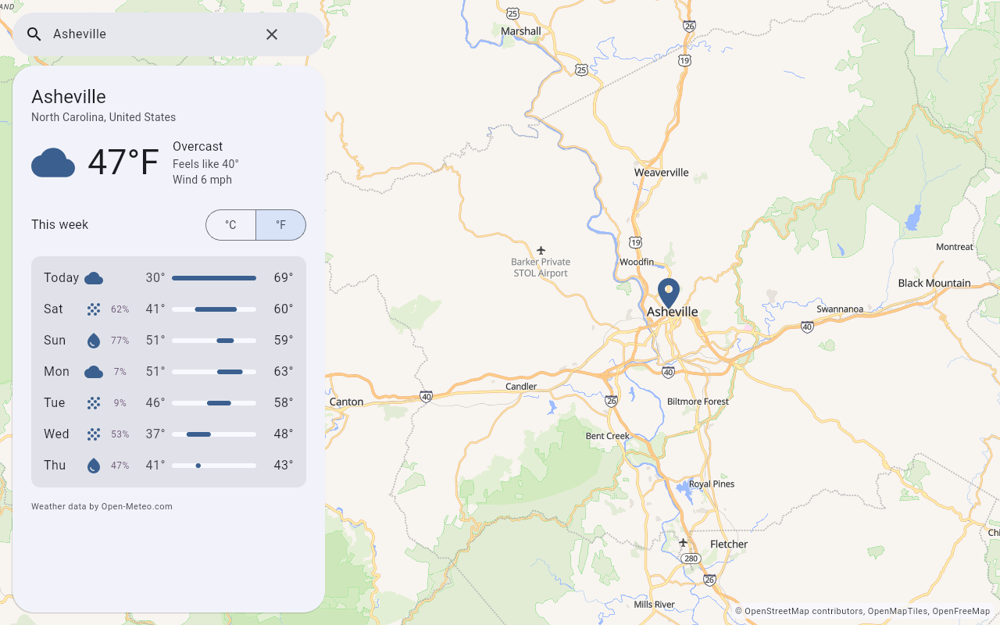
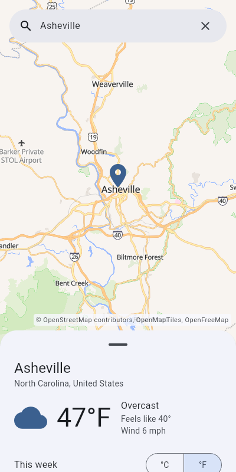

# kmp-weather

A weather app in Kotlin Multiplatform, with its screen shared through Compose
Multiplatform. One screen: a map with a Material 3 search bar over it. Search
for a place, or press and hold on the map, and the forecast for the week
appears.

**Live demo:** <https://calemccammon.github.io/kmp-weather/>

| Wide window                                                                                                 | Phone                                                                                         |
| ----------------------------------------------------------------------------------------------------------- | --------------------------------------------------------------------------------------------- |
|  |  |

It is one of six cross-platform builds of the same app, written to compare
the frameworks. The others are
[flutter-weather](https://github.com/calemccammon/flutter-weather),
[react-native-weather](https://github.com/calemccammon/react-native-weather),
[maui-weather](https://github.com/calemccammon/maui-weather),
[ionic-weather](https://github.com/calemccammon/ionic-weather) and
[capacitor-weather](https://github.com/calemccammon/capacitor-weather).
[android-weather](https://github.com/calemccammon/android-weather) is the
native Android build in Kotlin and Jetpack Compose, which goes further with
saved places, offline forecasts and a home-screen widget.

## What it does

- **Search as you type**, debounced; a late response to an older query never
  overwrites a newer one.
- **Pick a point** by pressing and holding on the map. With a mouse, use a
  right-click; holding the left button does nothing.
- **Forecast**: current conditions, then seven days with the chance of
  precipitation and a bar placing each day's low and high within the week's
  range.
- **Adapts to the window**: a draggable bottom sheet on a phone, a side panel
  from 840 dp wide. The map keeps the chosen place clear of both.
- **Celsius or Fahrenheit**, switched from the forecast and saved between
  launches. The default follows the device's region.
- **Light and dark** themes from one seed colour, following the system. The
  map changes style with them.
- **Accessible**: screen readers read each forecast block as one sentence,
  loading and errors are announced, and the forecast's columns widen with the
  device's text size.
- **Errors**: a timeout, no connection, a refused request and an
  overloaded service each get their own message and a Try again button.

## Architecture

Clean Architecture in three layers. Dependencies point inward only: `data`
and `ui` import `domain`, and `domain` imports neither, nor any library
except the Kotlin standard library and `kotlinx-datetime`. `ArchitectureTest`
checks every source file's imports and fails on one that breaks this.

All of it is in the `shared` module, under
`shared/src/commonMain/kotlin/com/calemccammon/weather/kmp`:

| Path     | What it holds                                                                                                                                                                                                                                                                                                 |
| -------- | ------------------------------------------------------------------------------------------------------------------------------------------------------------------------------------------------------------------------------------------------------------------------------------------------------------- |
| `domain` | The app's own types (`Place`, `Forecast`, `WeatherCondition`, `Units`), the repository interfaces (`WeatherRepository` with its failure kinds, `SettingsRepository`), and the use cases (`SearchPlaces`, `GetForecast`, `GetUnits`, `SetUnits`) that hold the rules. Plain Kotlin: no Compose, no Ktor.          |
| `data`   | Open-Meteo: the wire-shaped models (`*Dto`), their translation into domain types, and the repository implementation over Ktor. Settings are kept in each platform's own key-value store.                                                                                                                       |
| `ui`     | `core` has the theme, its design tokens and the mapping from domain values to wording and icons. `home` has `models` (what the screen shows, already rounded and worded), `viewmodels` (call use cases and produce those models) and `components` (render the models and never import the domain or data).      |
| `di`     | The Koin modules that bind each interface to its implementation and build the use cases and view models. Outside tests, only the platform entry points import it, to call `startDependencies()`.                                                                                                        |

All user-facing strings, screen-reader text included, are in
`shared/src/commonMain/composeResources/values/strings.xml`. View models
cannot resolve resources, so they emit a `UiText` (a string resource and its
format arguments), which is resolved when the screen is composed.

Each layer has its own model, with a mapping between them:

|              | Data                           | Domain       | UI                                                                         |
| ------------ | ------------------------------ | ------------ | -------------------------------------------------------------------------- |
| Type         | `ForecastDto`                  | `Forecast`   | `ForecastUiModel`                                                          |
| A day's high | `temperature_2m_max[1] = 64.3` | `high: 64.3` | `high`: "64°", `barEnd: 0.75`                                              |
| Conditions   | `weather_code: 3`              | `Overcast`   | an icon and "Overcast"                                                     |
| A failure    | HTTP 400, a timeout            | `Rejected`   | `failure_rejected`: "The weather service refused the request."             |

State is held by two view models, `HomeViewModel` and `SearchViewModel`, each
an `androidx.lifecycle.ViewModel` exposing one `StateFlow`. A request that is
superseded (another place selected, more text typed) is cancelled, so a stale
response can never land.

The platform modules are thin. `androidApp`, `desktopApp`, `webApp` and
`iosApp` each start the dependencies and show the shared `App()`. Inside
`shared`, the only platform-specific code reads the device's country and
creates the iOS view controller.

## Running

Kotlin 2.4, Compose Multiplatform 1.12. Targets: Android, desktop (JVM), web
and iOS.

```sh
./gradlew :androidApp:installDebug          # onto a running emulator or device
./gradlew :desktopApp:run                   # a desktop window
./gradlew :webApp:jsBrowserDevelopmentRun   # in a browser, rebuilding on change
./gradlew :webApp:jsBrowserDistribution     # static site in webApp/build/dist/js/productionExecutable
```

Gradle needs Java 21 to run. The desktop app is built and run with Java 25,
which MapLibre's desktop build needs; Gradle downloads it the first time.

The iOS app is in `iosApp`, to open in Xcode on a Mac. Its Kotlin code is
compiled in CI, but the app itself has not been built or run.

## Checks

```sh
./gradlew ktlintCheck detekt :androidApp:lintDebug   # `./gradlew ktlintFormat` fixes formatting
./gradlew :shared:jvmTest                            # every test
./gradlew :shared:testAndroidHostTest :shared:jsTest # the domain and data tests again, on Android and in a browser
```

The UI tests render the screen in an offscreen desktop window with a fake
map, so they run on the JVM only. The browser
tests need Chrome; set `CHROME_BIN` if it is not where Karma looks.

`.github/workflows/ci.yml` runs all of these on pushes to `main` and on pull
requests, compiles the iOS code, then builds the Android debug APK, the
desktop app and the web app. The APK and the web app are uploaded as workflow
artifacts.

`.github/workflows/pages.yml` builds the web app and publishes the live
demo. It runs only when started by hand from the Actions tab.

## Data and credits

- Place search and forecasts: [Open-Meteo](https://open-meteo.com/) (no key;
  free for non-commercial use; CC BY 4.0).
- Map: [OpenFreeMap](https://openfreemap.org/) styles and tiles (no key),
  from [OpenMapTiles](https://openmaptiles.org/) and
  © [OpenStreetMap](https://www.openstreetmap.org/copyright) contributors,
  drawn with [MapLibre](https://maplibre.org/) through
  [MapLibre Compose](https://maplibre.org/maplibre-compose/).

## Known limits

- **English only.** All strings, weekday names included, are in one
  `strings.xml`, so adding a language means adding one file.
- **Places are not saved**: the chosen place is forgotten when the app
  closes. Only the choice of units is kept.
- **The web app is JavaScript, not WebAssembly.** MapLibre Compose has no
  Wasm build, and its API is not yet stable.
- **The desktop app is set up for Linux on x64.** MapLibre ships its native
  code per system; another one needs its own artifact in
  `desktopApp/build.gradle.kts`.
- **Very large text** widens the forecast's columns and drops the range bar
  when there is no room, but the rows do not shrink to fit beyond that.

## Not built

Ideas that were considered and left out, roughly in the order they would be
worth doing:

- **Saved places** shown when the app opens.
- **Forecast for the current location**, which needs the location permission
  on each platform.
- **A second language**, to exercise the localisation set-up.
